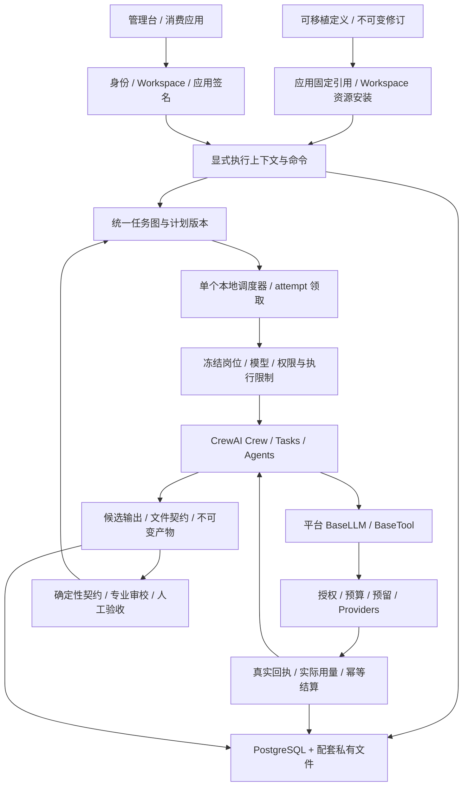

# Orchpact：声明、团队执行与持久化边界

Orchpact 以自托管服务承载可复用的工作流声明和持久化运行时。CrewAI 在受控的工作项内执行团队协作；Orchpact 维护跨团队阶段、权限、资源、账务、交付与验收。应用通过公开协议消费工作流，业务字段与领域规则由应用或定义表达。

## 两层执行架构

图中的 CrewAI 执行路径适用于文本团队工作；图片任务通过平台图片提供者，确定性汇总节点直接复用实际产物。两者同样受平台授权、账务、文件和验收规则约束。

| 层 | 主要实现 | 负责的事实 |
| --- | --- | --- |
| 领域契约 | `kernel/` | 工作流、组织、计划、命令与交付的纯结构及校验 |
| 工作流服务 | `services/` | 定义发布与安装、唯一调度器、工作项与尝试、授权、账务、治理和验收 |
| 团队执行 | `services/executor.py`、`services/teams.py`、`adapters/crewai.py` | 冻结团队名单，装配 CrewAI 运行对象，将模型和工具效果接回平台 |
| 基础设施 | `adapters/` | PostgreSQL、身份、提供者传输、文件与实例配置 |
| 集成入口 | `interfaces/` | HTTP、管理客户端与外部调用边界 |

`bootstrap.Instance` 先获得文件目录锁和 PostgreSQL 会话 advisory lock，再安装统一 schema 和服务；lifespan 结束前排空工作线程。CrewAI 运行在同一实例进程内，不是额外部署的 Agent 服务。

## 执行团队与工作流运行时

团队声明保存在 units.crew，每次启动装配独立的 Crew、Task 与参与岗位 Agent。CrewAI 负责团队内部任务推进、上下文交接、工具选择和多轮行动。Orchpact 通过模型与工具适配器控制每次真实调用，维护授权、账务、持久化步骤和最终交付。跨业务阶段的依赖、交付验收与返工都通过平台统一任务图执行。

团队声明与实例的映射见 [执行团队](TEAM_EXECUTION.md)。具体责任归属、执行时序、停止条件和恢复规则见 [Orchpact 与 CrewAI 的职责边界](EXECUTION_BOUNDARY.md)。模型输出与工具观察均不会直接改写平台状态。

团队内部按照声明的 `participants` 顺序运行岗位 Task，前序岗位返回有界 notes，末位岗位提交阶段契约 JSON。跨团队传递的是平台产物及其身份、哈希和代次，不能用团队对话替代依赖与验收。当前不启用层级 Manager、自主跨岗位委派或共享持久记忆。

一次 attempt 默认共享 12 个模型决策步骤、8 个工具步骤、300 秒和 128000 字符消息历史的额度。增加成员、有界协议修正或再次启动 Crew 不会刷新该 attempt 的限额。各次实际供应商请求仍独立预留与计费；取消和时限在行动边界检查，已发出的请求可能继续返回。

## 定义、安装与执行

工作流目录及其不可变修订独立于应用。应用绑定固定引用工作流 ID 与修订；同一资产可被多个独立应用消费。可复用工作流以 `orchpact-workflow` JSON 表达职责、契约、计划与能力槽位。安装时将槽位绑定到使用方模型，并为 Workspace 创建独立职责实例。执行记录保存定义指纹、登记修订与绑定，任务与调用保存既有不可变快照。定义管理、资源绑定与运行状态分别处理；管理台只是入口。格式与边界见 [工作流抽象](WORKFLOWS.md)。

| 边界 | 保存内容 | 更新语义 |
| --- | --- | --- |
| 定义发布 | 工作流 ID、作者 version、目录 revision、定义 SHA-256 | 追加修订，不覆盖已发布版本 |
| 应用引用 | 应用 ID、签名身份、明确工作流修订、应用绑定 revision | 独立于定义发布，不使用隐式 latest |
| 空间安装 | Workspace、应用、已安装修订、模型槽位映射与组织实例 | 预览并确认两类修订，拒绝过期安装请求 |
| 执行快照 | 来源与绑定、输入、付款人；工作项创建时的职责、岗位、能力、模型与规则 | 后续配置不回写已保存快照；明确重试沿用工作项快照 |

导出只分享定义层；模型 ID、密钥、用户身份、安装记录和运行数据不进入可移植结构。提示词和业务 Schema 是作者内容，仍需要作者在分享前审阅。

## 三种关系

`units` / `agents` 表达 Workspace 内的长期职责；`participations` 记录具体项目参与；`mandates` 表达有范围和有效期的行动权。上下级关系不会自动授予验收或委派权限。核心不创建固定“监察部”，规则由 Governance 执行，专业审校是可配置的独立工作项。

每个内核变更接收 `ExecutionContext`。HTTP 层的 ContextVar 仅用于HTTP 身份桥接，调度器不借用浏览器当前会话。任务主体来自领取的尝试，调用能力还受角色快照约束，不能因为共享模型支持搜索就自动搜索。

## 一个执行机制

组织包中的原生计划和自主规划器的提案都生成同一 `tasks` / `dependencies` 图。原生阶段直接交付 JSON 对象；平台完成一次序列化。组节点按文件名汇总下级真实交付，不额外调用模型。所有计划共用同一套执行与推进机制。

工作项创建时保存职责、角色、模型、输入约定和治理快照。计划修改只允许未开始的节点，支持新增、改描述/依赖和取消；改动有理由、幂等键和 revision，并使用初始计划相同的 DAG、契约、规则及返工范围校验。已有产物不覆盖。

当前硬边界：每项目最多 48 个任务、每项最多 12 次执行、合计最多 96 次；原生计划最多 40 节点与 3 次自动返工。显式重试也不绕过生命周期上限。并发 1–64 个线程，每项目有独立并发限制和公平领取顺序。

## 状态与验收

`queued/running/waiting` 表示推进状态；`completed/partial/failed/interrupted/rejected/cancelled` 表示工作项结果。项目只有根产物通过当前验收才是 completed。专业审校失败触发有界定向返工；旧审校不能用于新产物。人工验收绑定产物 ID、SHA-256 和 generation。

独立验收策略阻止系统自动接受。部分交付提供文件及明确缺口，结构化 `result` 仅在完整完成时返回。专业任务成功与最终汇总失败分别保存，汇总重试复用已有文件。

| 情景 | 工作流处理 | 必须保留的依据 |
| --- | --- | --- |
| 正常完成 | 候选输出通过契约，发布产物并完成适用验收 | 实际产物身份与验收记录 |
| 审校返工 | 在规则允许的节点及次数内创建新的交付代次并重新审校 | 旧产物、问题、新产物和新的审校引用 |
| 外部结果未知 | 中止当前工作，保持尚不能结算的预留，等待真实回执或人工核定 | 原请求、原付款人、未知用量与恢复记录 |

后者不能自动进入“再次调用直到成功”；一次请求可能已产生供应商费用。CrewAI 最终回答、框架重放日志和框架用量汇总都不能替代平台事实。

## 执行记录与恢复

`crew_runs` 记录每次实际团队启动和参与名单；`agent_steps` 关联工作项、attempt、Crew、岗位和运行 Agent。查询 run 仅提供同一权限范围内的步骤元数据，模型输出与工具参数/观察保存在私有 `var/agent-steps/`，供应商原始回执在 `var/receipts/`。

重启先恢复已有回执与结算；未完成工作转为 interrupted，不能确认结果的步骤保留 unknown。系统不恢复 CrewAI 内存循环或自动重放付费工具，明确重试创建新的 attempt 与运行对象。框架辅助目录与内存日志不承担持久化工作流、账务或恢复真相。

## 存储与账务

独立 PostgreSQL 数据库包含 `orchpact-postgresql-v1` 格式标识及 `schema_migrations`；本地 `var/database-instance` 与库中的文件实例 ID 绑定，拒绝错误配对。原生 PostgreSQL DDL 统一位于 `adapters/schema.py`，使用 `%s` 参数、JSONB 查询、identity 序列、BIGINT 账务。后续升级经持锁命名迁移执行并先生成 `pg_dump` 备份。初始化只接受专用空库或格式匹配的 Orchpact 数据库。

仍为单主进程：每个数据库只允许一个 Orchpact owner，即使本地目录不同也拒绝第二个主进程。短写事务通过数据库事务级 advisory lock 串行化，保留预算检查、预留、任务领取和幂等的一致边界；读取使用独立 MVCC 连接。所有权会话失效后拒绝后续写入，readyz 失败；不自动接管或重发未知外部请求。此实现没有宣称支持多主调度。连接上下文退出时提交/回滚并关闭，写事务启用 `synchronous_commit=on`。参见 [存储运维](POSTGRESQL.md)。

数据库事务同时提交业务、状态、账务与事件。文件写入 fsync 后登记不可变对象，事务失败留下的旧孤立文件由延迟清理回收。回执独立持久化，重启先恢复结算再领取工作；取消不抹除已发生费用。未知 Token 不等于零。

价格在调用预留时快照，原付款人固定在项目上。授权和预算在每次新行动前复查；父委托预算汇总后代实际调用。幂等键绑定内容指纹，不能复用于另一请求。

## 能力边界

消费者通过公开 API 调用工作流。业务字段、页面与领域规则由消费应用或可移植工作流定义表达，服务内核不装配消费应用的业务模块。

这是单主进程模块化单体，未实现远程 Worker、第三方代码插件、任意代码执行或自动部署。HTTP 响应有应用层解析边界；部分供应商传输使用 eager buffering，不能把它声称为网络层流式内存硬限制。内容质量与真实供应商行为须由独立评估证明。
