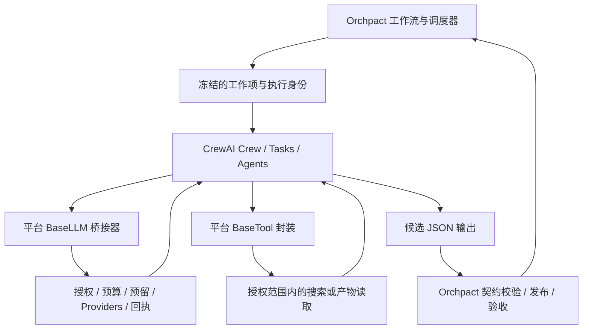

# Orchpact 与 CrewAI：职责边界和执行适配

状态：实现与验收以本仓库代码和测试为准。本文分别定义两者的职责，再说明组合方式。工作流格式不会依赖 CrewAI 的 Python 对象。

## Orchpact 的独立职责

Orchpact 是可自托管的组织协作工作流引擎。它描述职责、依赖、输入输出、授权、交付与验收，并将可移植的定义发布为不可覆盖的修订。应用固定引用定义，Workspace 安装自己的资源绑定；每次执行保存当时的定义、资源、角色与付款人快照。

Orchpact 维护业务阶段图、团队启动、执行尝试、跨团队交付、问题回复、取消、审校与有界返工。它在服务端检查应用和 Workspace 隔离，管理预算、积分预留、用量、真实回执、不可变文件与审计。生成内容只有经过平台契约与验收后才构成已接受交付。

这些规则属于工作流运行时，不由单个 Agent 的提示词、内存或最终回答决定。

## CrewAI 的独立职责

CrewAI 是 Agent 执行框架，提供角色配置、模型交互、工具调用、观察反馈与多轮行动等能力。其完整框架也包含团队编排、Flows、记忆和其他能力；本项目采用 Crew、Task 与 Agent 执行团队协作。

本项目将参与岗位装配成新的 Agent 和 Task，通过 `Crew.kickoff()` 执行当前团队工作，使用 `BaseLLM` 接入平台模型传输，通过 `BaseTool` 注册受控工具。CrewAI 维护团队内部的任务推进、岗位上下文交接，以及各 Agent 的行动循环和工具观察，返回候选结果。它不直接修改平台工作流、授予权限、选择付款人或接受交付。

当前依赖范围为 CrewAI 1.15.41 至 1.16 之前的版本，具体版本由 `uv.lock` 固定。升级依赖需要重新运行适配契约测试。参考：[团队执行](https://docs.crewai.com/en/concepts/crews)、[自定义模型](https://docs.crewai.com/en/learn/custom-llm)、[工具](https://docs.crewai.com/en/concepts/tools)。

部门／小组是可复用团队声明，每次执行创建新的 Crew 和参与岗位 Agent，实例不跨项目或重试复用。完整数据模型、参与名单、并发隔离和顺序协作示例见 [执行团队设计](TEAM_EXECUTION.md)。

## 责任归属

| 能力或事实 | 负责方 | 适配约束 |
| --- | --- | --- |
| 定义、发布修订、应用绑定、空间安装 | Orchpact | 公开 JSON 不嵌入 Crew、Task、Python 回调或实例凭据 |
| 业务阶段领取、依赖与跨团队衔接 | Orchpact | 根据声明启动团队工作并检查交付；工作流变更须通过平台命令 |
| 团队内部任务推进与岗位上下文交接 | CrewAI | 按声明装配 Tasks 与 Agents，由 Crew 的顺序流程执行 |
| 单个工作项内的下一步行动 | CrewAI | 从当前提供的工具中选择，观察后继续或提交候选结果 |
| 模型交互和行动协议 | CrewAI + 模型桥接器 | 每个 Agent 使用自身岗位绑定的 `BaseLLM`；JSON 决策转换为 CrewAI 工具/最终结果协议 |
| 每次模型和搜索请求 | Orchpact Providers | 每次重新授权、校验预算、预留、保存供应商回执并按实际用量结算 |
| 工具列表、参数、数据范围与副作用 | Orchpact | `BaseTool` 调用平台服务；框架工具不能绕过平台自行联网或读文件 |
| 行动循环内的消息与观察 | CrewAI | 只限本工作项；平台限制上下文，工具内容按不可信数据处理 |
| 执行步骤、请求、账务和状态真相 | Orchpact | PostgreSQL 和配套私有文件是持久化来源；不采用框架用量汇总作为扣账依据 |
| 产物发布、专业审校与最终状态 | Orchpact | CrewAI 的最终回答是候选输出，仍须经过 Schema、文件和验收规则 |
| 重启恢复与未知外部结果 | Orchpact | 先恢复回执和结算；不自动恢复 CrewAI 循环或重发未知付费请求 |

CrewAI 的内部执行器可以使用其自己的控制流实现，但业务工作流仍由 Orchpact 的统一任务图维护，不再建立另一份 CrewAI Flow 业务定义。

## 执行路径

1. 调度器在事务内领取工作项，生成唯一 attempt；任务快照包含执行框架版本与限制。
2. 执行器组装职责、当前输入和允许引用的依赖产物。每个 CrewAI Task 使用固定入口描述；实际用户内容经平台模型桥接器提供，避免框架自动发现输入 URL 并触发额外下载。
3. 每次模型决策都经平台 JSON 协议校验。模型可提交最终契约 JSON，也可提交 `{"tool":"search_evidence","arguments":{"query":"..."}}`。桥接器将后者转换为 CrewAI 行动协议，由 CrewAI 实际调度注册工具并将观察加入下一轮。
4. 工具执行前再次检查当前 attempt、授权、成员资格、期限、能力与平台停止标志。搜索继续受每来源额度与实际预算限制。
5. 候选输出交回平台。结构通过不代表专业内容已经验收；独立审校与返工仍由工作流推进。

## 当前工具范围

- `search_evidence`：仅向冻结角色具有 `search` 能力的工作项提供，并检查剩余搜索额度。实际调用复用平台搜索提供者；各来源分别保存回执与费用。
- `read_artifact`：仅在工作项有依赖交付时提供。只接受当前上下文中明确列出的产物 ID，再检查同一项目；不接受任意路径。结果保留文件哈希、清单和截断标记。

未声明执行团队的组织规划和接收阶段使用单岗位 Crew 生成受约束命令提案，不向其开放上述执行工具。图片调用继续使用平台图片提供者。工具集合由平台能力边界决定，工作流不会加载任意 Python 工具插件。

## 执行边界与停止规则

默认每个 attempt 最多 12 个模型决策步骤、8 个工具执行步骤，墙钟期限为 300 秒，CrewAI 消息历史最多 128000 字符。限制在工作项创建时快照，同一 attempt 内的协议修正和再次进入 Agent 共享计数。平台项目请求与预算上限同时生效；JSON 协议修正的每次实际请求仍分别计费。

搜索工具观察先保留来源 URL、身份和实际调用元数据，再缩短各来源摘录，始终返回完整 JSON 并标明截断；极端情况下显式省略整条来源。原始供应商回执与工具结果保留在私有执行记录中。不能用直接截断 JSON 文本的方式隐藏后续来源或回执。

契约修正反馈指出实际文件、缺失字段及允许字段，不回显字段值。声明中的提示词、审校标准和输出 Schema 必须一致，审校不能要求 Schema 禁止的字段。

时限和取消在行动边界检查。已经发出的网络请求可能继续返回并产生费用；平台保存真实回执，随后阻止下一次行动或产物发布。达到步骤、预算或上下文上限时明确中止，不把框架的尽力回答自动接受为成功。

关闭框架自动重试、工具缓存、代码执行、跨 Agent 委派、持久记忆、自动上下文压缩和额外输入能力。传输失败、授权失效或工具执行异常通过适配层中止循环，不能被框架当作普通观察后反复调用。受控的 JSON 修正与明确重试保留平台本身的边界。

本嵌入运行方式关闭 CrewAI 遥测和远端 tracing，并禁止上游隐式加载工作目录 `.env`。框架初始化的辅助目录明确放在实例 `var/crewai-runtime/`，容器服务账号的 home 也位于此辅助目录，容纳上游初始化的认证元数据；不要求宿主用户登录 CrewAI。该目录不承担工作流、账务或恢复状态。实例配置仍由 Orchpact 的显式实例根目录解析。

## 持久化、恢复与可见性

`crew_runs` 记录实际 Crew、参与名单与 Agent ID；`agent_steps` 通过 crew_run_id、member_key 和 runtime_agent_id 关联团队执行，并记录工作项、attempt、步骤序号、模型/工具类型、名称和状态。状态为 started、completed、failed 或 unknown。实际输出、工具参数和观察保存到配套私有 `var/agent-steps/`，不将内容写入事件或审计摘要。供应商原始回执仍保存在 `var/receipts/`，账务与原付款人机制保持独立。

查询 run 的 `agent_steps` 返回步骤元数据，沿用 run 的应用和 Workspace 授权。它用于解释 Agent 如何推进，不授予额外数据权限。

重启只恢复已有证据与结算；正在执行的工作项变为 interrupted，缺少确认回执的步骤标为 unknown。系统不自动恢复框架检查点或重放工具。用户明确重试会创建新的 attempt，并继续受到原付款人、请求总额和工作流返工上限约束。

## 验收要求

适配测试必须使用真实 CrewAI Crew、岗位 Agent 与工具循环、隔离 PostgreSQL 和模拟外部传输，覆盖：多轮选工具、范围与参数拒绝、撤销与取消、预算耗尽、步骤上限、未知用量、供应商超时不重发、回执恢复及步骤持久化。平台原有授权、账务、计划、审校和文件测试继续执行。

模拟传输证明适配与状态语义；真实任务完成质量、上下文策略效果和供应商工具选择表现需要另外评估。
